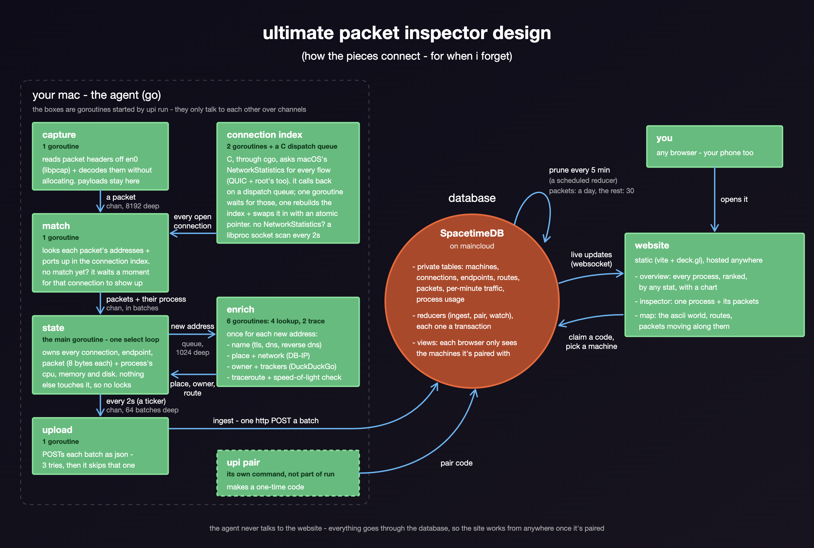

# ultimate packet inspector

draws a line from your computer to every computer it talks to, on an ascii map of the world - and tells you which app is talking, who's on the other end, and how the traffic gets there.

it's for answering "where is my data going, and who's watching?" - not just what each app on your machine is doing, but where its traffic actually ends up.

- **place first.** every remote host is a line on the map, in the colour of the process talking to it
- **every process, ranked.** sort them by any of 51 stats - data up or down, packets, cpu, memory, disk, how far their traffic reaches, how many countries or trackers they talk to, how long they've been alive - and open any one in the inspector
- **who's watching.** every domain is matched to the company that owns it, and trackers are flagged (DuckDuckGo's tracker data)
- **path & physics.** each destination gets a traceroute, and the line follows the real routers - along the actual undersea cable when it crosses an ocean. round trip times are checked against the speed of light: if something answers in 3ms, geo-ip saying it's in Sydney can't be right, so that answer's ignored
- **every packet, recorded.** every packet header goes into SpacetimeDB, so the site can show your machine live from anywhere (your phone, say)



## how it works

**the agent** (`agent/`) captures every packet on `en0` with libpcap and decodes it without allocating (~40ns a packet). each one is then matched to its process. macOS can list every open connection - which process owns it, and the address and port at each end - so a packet's own addresses and ports are looked up in that list. the list comes from NetworkStatistics, the private framework `nettop` uses, which sees every flow including QUIC and root's, without root; where that isn't available, the agent scans every process's sockets with libproc instead. both are small C files the agent calls through cgo (`agent/procs/c_files`).

after a packet's matched, everything slow happens off the packet path, once per new address: DB-IP for location and network, the TLS server name or a DNS answer or a reverse lookup for the name, DuckDuckGo's tracker data for the owner, then a traceroute (macOS lets anyone send ICMP echo, so no root) whose routers are placed by the airport or city codes in their names when those fit the round trip time. where this machine is comes from its public address (asked of OpenDNS) in DB-IP, or `home` in the config.

every 2 seconds the agent sends one batch to the module's `ingest` reducer over SpacetimeDB's HTTP API: connection totals, new endpoints and routes, every packet header - 8 bytes each (time, size, direction + tcp flags, ttl), packed per connection - and what each process with a connection has cost since the last batch: cpu time, memory and disk (`proc_pid_rusage` - only your own user's processes will say), plus when it started (anyone's). above `-max-pps` (5000) it records 1 in n packets, marked with a weight, so a big download can't blow the database's budget; byte and packet counts always stay exact.

**the module** (`module/`) keeps everything in private tables. websites see data only through views, and only for machines they've paired with using a one-time code from `upi pair`. a website picks what it's looking at (a machine, live or a past window) by writing a `watch` row that the views read. packet headers and process stats are kept for a day, everything else (connections, endpoints, routes, per-minute traffic) for 30 days.

**the website** (`web/`) is a static Vite + deck.gl site, laid out from a Figma design - no tiles, no map service.

- **overview**: every process, one row per pid, ranked by whichever stat the "sorted by" menu's on, with a chart of the top eight over the last 15 minutes (hover it for the values). open a process for its connections, pin it to keep it on top, or inspect it
- **inspector**: one process close up - what it's sent and received, open connections, latency, cpu and memory, what it's connected to and its recent packets - with only its lines on the map. ↑/↓ steps through the processes
- **the map**: click a line for who's on the other end. its traceroute is in a dropdown on that card, and opening it shows the routers on the map. where geo-ip's answer doesn't fit the round trip, the line ends at the last router on its route that does

the basemap is the world drawn in ascii, live (`web/src/ascii.ts`): every character on screen looks up the ground under it, so zooming in brings out detail instead of bigger letters. it draws from one 3MB image (`web/public/data/ascii-world.png`) that `scripts/tif-to-ascii.py` exports from Natural Earth's shaded-relief raster - to rebuild it, put `NE1_HR_LC_SR_W_DR.tif` in the repo's root and run `scripts/tif-to-ascii.py --png web/public/data/ascii-world.png`. the same script turns any tiff into ascii art in the terminal (`--help`). country borders are traced through the character grid as `- | / \` (built into `web/public/data/borders.json` by `npm run overlays`), and so are the connections, over a fine solid line so they read as lines from a distance. how all of that looks - character sizes, opacities, how strong the line under the connections is - is the `ASCII` settings at the top of `ascii.ts`.

to restyle it: every colour on the site is in `web/src/colors.css` (the map's canvases read them too), and `--overview-scale` in `web/src/style.css` sizes the overview's text and spacing. processes get their colour from their pid, from `--process-1` to `--process-8`.

## setup

needs: macOS, Go 1.26+, Node 22+, Wireshark's ChmodBPF (or anything else that puts you in the `access_bpf` group) so capture works without sudo.

0. **say where the database is** - once, for everything. the agent, the website's build and the module's deploy all read the repo's `.env`:

   ```sh
   cp .env.example .env   # then set UPI_DB (and UPI_SITE once the site's hosted)
   ```

   real environment variables override it - which is how a host that builds the site (and has no `.env`) gets told: set `UPI_DB` (and `UPI_SERVER` if it isn't maincloud) in its build settings.

1. **SpacetimeDB.** install the cli and log in, then publish the module:

   ```sh
   curl -sSf https://install.spacetimedb.com | sh
   spacetime login
   cd module && npm install && npm run deploy   # spacetime publish, to UPI_DB on UPI_SERVER
   ```

   changing the module later? `npm run deploy` again migrates it in place - new tables, and new columns with defaults, keep everything that's there. a change spacetime can't migrate is refused unless you pass `--delete-data`, which wipes the database.

2. **the agent.**

   ```sh
   scripts/fetch-geo.sh                 # DB-IP databases, ~140MB, into ~/Library/Application Support/upi
   cd agent && go build -o upi .
   ./upi dump                           # try it: prints batches as json, uploads nothing
   ./upi run                            # it finds the repo's .env from where it's run, or from where the binary is
   ./upi install                        # run at login with launchd (logs: ~/Library/Logs/upi.log)
   ```

3. **the website.**

   ```sh
   cd web && npm install
   npm run generate                     # client bindings from ../module - again whenever the module changes
   npm run build                        # static files in dist/ - host them anywhere
   ```

4. **pair.** run `./upi pair` on the machine and open the link it prints (or type the code into the site). `./upi revoke` unpairs everyone.

`npm run dev` and open `/#demo` to work on the site without any of the above - it plays back `web/public/demo/batches.jsonl`, which you make with `./upi dump -chunks -for 60s > ../web/public/demo/batches.jsonl` (gitignored - it's your real traffic).

## tests

```sh
cd agent && go test ./...                         # decode, match, physics, owners, router names, process usage, batches
cd agent && go test -bench . -benchmem ./capture  # 0 allocs/op on the packet path
cd module && npm test                             # the module on SpacetimeDB's portable datastore
cd web && npm test                                # chunk decoding, geometry, cable routing, the ascii map, every stat
```

`testdata/` holds fixtures the go agent writes and the module and website read, so the three can't drift apart (`UPDATE_FIXTURE=1 go test ./...` rewrites them).

## privacy

the agent uploads connection metadata - process names and pids, the addresses and names of everything you talk to, packet sizes and timings, and how much cpu, memory and disk each connected process uses - to SpacetimeDB. payloads never leave the machine (only a yes/no for "this looked unencrypted"). on maincloud that data lives on Clockwork Labs' servers; self-host SpacetimeDB if that's not ok.

## credits

IP geolocation by [DB-IP](https://db-ip.com) (CC BY 4.0) · submarine cables from [TeleGeography](https://www.submarinecablemap.com) (CC BY-SA 4.0) · domain owners from [DuckDuckGo's tracker blocklists](https://github.com/duckduckgo/tracker-blocklists) (CC BY-NC-SA 4.0) · map from [Natural Earth](https://www.naturalearthdata.com) (public domain) - the shaded-relief raster for the ascii and the borders, and world-atlas's outlines for telling sea from land · airports from [OurAirports](https://ourairports.com) (public domain) · [Roboto Mono](https://fonts.google.com/specimen/Roboto+Mono) (SIL Open Font License), via Fontsource
