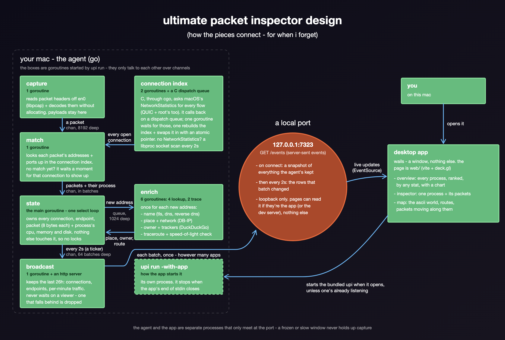

# ultimate packet inspector

*desktop app branch* - upi without a intermediate database, just a local view of your computer activity. still two processes, but no intermediate database - data is streamed over a port directly from the backend.


draws a line from your computer to every computer it talks to, on an ascii map of the world - and tells you which app is talking, who's on the other end, and how the traffic gets there.

it's for answering "where is my data going, and who's watching?" - not just what each app on your machine is doing, but where its traffic actually ends up.

- **place first.** every remote host is a line on the map, in the colour of the process talking to it
- **every process, ranked.** sort them by any of 51 stats - data up or down, packets, cpu, memory, disk, how far their traffic reaches, how many countries or trackers they talk to, how long they've been alive - and open any one in the inspector
- **who's watching.** every domain is matched to the company that owns it, and trackers are flagged (DuckDuckGo's tracker data)
- **path & physics.** each destination gets a traceroute, and the line follows the real routers - along the actual undersea cable when it crosses an ocean. round trip times are checked against the speed of light: if something answers in 3ms, geo-ip saying it's in Sydney can't be right, so that answer's ignored
- **every packet, live.** every packet header is drawn as it happens, moving along its connection's line - and none of it leaves your machine



## how it works

**the agent** (`agent/`) captures every packet on `en0` with libpcap and decodes it without allocating (~40ns a packet). each one is then matched to its process. macOS can list every open connection - which process owns it, and the address and port at each end - so a packet's own addresses and ports are looked up in that list. the list comes from NetworkStatistics, the private framework `nettop` uses, which sees every flow including QUIC and root's, without root; where that isn't available, the agent scans every process's sockets with libproc instead. both are small C files the agent calls through cgo (`agent/procs/c_files`).

after a packet's matched, everything slow happens off the packet path, once per new address: DB-IP for location and network, the TLS server name or a DNS answer or a reverse lookup for the name, DuckDuckGo's tracker data for the owner, then a traceroute (macOS lets anyone send ICMP echo, so no root) whose routers are placed by the airport or city codes in their names when those fit the round trip time. where this machine is comes from its public address (asked of OpenDNS, or over https when a network blocks that) in DB-IP, or `home` in the config.

every 2 seconds the agent makes one batch: connection totals, new endpoints and routes, every packet header - 8 bytes each (time, size, direction + tcp flags, ttl), packed per connection - and what each process with a connection has cost since the last batch: cpu time, memory and disk (`proc_pid_rusage` - only your own user's processes will say), plus when it started (anyone's). above `-max-pps` (5000) it records 1 in n packets, marked with a weight, so a big download can't swamp the app; byte and packet counts always stay exact.

**the broadcast** (`agent/broadcast`) keeps a rolling picture of the last 26 hours - connections, endpoints, routes, per-minute traffic and process usage, plus the last 30 seconds of packets - and serves it on `127.0.0.1:7323` as server-sent events: everything at once when a viewer connects, then the rows each batch changed. it never waits on a viewer - one that falls behind is dropped, and catches up from a fresh snapshot - so nothing on the screen can hold up capture. it only listens on a loopback address, and only the desktop app (or the web app's dev server) can read it from a page.

**the desktop app** (`desktop/`) is a Wails window and nothing else. when it opens it starts the `upi` that ships inside it, as its own process (unless an agent's already listening), and stops it when it quits. the page inside it is the web app.

**the web app** (`web/`) is Vite + deck.gl, laid out from a Figma design - no tiles, no map service.

- **overview**: every process, one row per pid, ranked by whichever stat the "sorted by" menu's on, with a chart of the top eight over the last 15 minutes (hover it for the values). open a process for its connections, pin it to keep it on top, or inspect it
- **inspector**: one process close up - what it's sent and received, open connections, latency, cpu and memory, what it's connected to and its recent packets - with only its lines on the map. ↑/↓ steps through the processes
- **the map**: click a line for who's on the other end. its traceroute is in a dropdown on that card, and opening it shows the routers on the map. where geo-ip's answer doesn't fit the round trip, the line ends at the last router on its route that does

the basemap is the world drawn in ascii, live (`web/src/ascii.ts`): every character on screen looks up the ground under it, so zooming in brings out detail instead of bigger letters. it draws from one 3MB image (`web/public/data/ascii-world.png`) that `scripts/tif-to-ascii.py` exports from Natural Earth's shaded-relief raster - to rebuild it, put `NE1_HR_LC_SR_W_DR.tif` in the repo's root and run `scripts/tif-to-ascii.py --png web/public/data/ascii-world.png`. the same script turns any tiff into ascii art in the terminal (`--help`). country borders are traced through the character grid as `- | / \` (built into `web/public/data/borders.json` by `npm run overlays`), and so are the connections, over a fine solid line so they read as lines from a distance. how all of that looks - character sizes, opacities, how strong the line under the connections is - is the `ASCII` settings at the top of `ascii.ts`.

to restyle it: every colour in the app is in `web/src/colors.css` (the map's canvases read them too), and `--overview-scale` in `web/src/style.css` sizes the overview's text and spacing. processes get their colour from their pid, from `--process-1` to `--process-8`.

## setup

needs: macOS, Go 1.26+, Node 22+, [Wails](https://wails.io) (`go install github.com/wailsapp/wails/v2/cmd/wails@latest`), Wireshark's ChmodBPF (or anything else that puts you in the `access_bpf` group) so capture works without sudo.

```sh
scripts/fetch-geo.sh     # DB-IP databases, ~140MB, into ~/Library/Application Support/upi
scripts/build-app.sh     # builds "ultimate packet inspector.app", with the agent inside, in the repo's root
```

then open the app. it starts the agent and shows everything as it arrives.

working on it:

```sh
cd agent && go build -o upi .   # the agent on its own
./upi dump                      # try it: prints batches as json
./upi run                       # broadcasts on 127.0.0.1:7323 (-listen to move it)
./upi install                   # or run it at login with launchd (logs: ~/Library/Logs/upi.log) - the app uses it when it's there
cd desktop && wails dev         # the app, reloading as web/ changes - it starts ../agent/upi
```

`scripts/install-agent.sh` puts `upi` on your PATH. `npm run dev` in `web/` and open `/#demo` to work on the page without an agent - it plays back `web/public/demo/batches.jsonl`, which you make with `./upi dump -chunks -for 60s > ../web/public/demo/batches.jsonl` (gitignored - it's your real traffic).

## tests

```sh
cd agent && go test ./...                         # decode, match, physics, owners, router names, process usage, batches, the broadcast
cd agent && go test -bench . -benchmem ./capture  # 0 allocs/op on the packet path
cd web && npm test                                # chunk decoding, geometry, cable routing, the ascii map, every stat
```

`testdata/` holds fixtures the agent writes and the broadcast and web app read, so they can't drift apart (`UPDATE_FIXTURE=1 go test ./...` rewrites them).

## privacy

nothing you capture leaves your machine: the agent serves it on a loopback address, to the app on the same machine, and keeps it in memory only. the only things it sends out are its own lookups - reverse dns, traceroutes, and asking OpenDNS (or ipify / icanhazip, when a network blocks outside dns) for your public address to place you on the map. set `home` in `~/Library/Application Support/upi/config.json` to skip that last one.

## credits

IP geolocation by [DB-IP](https://db-ip.com) (CC BY 4.0) · submarine cables from [TeleGeography](https://www.submarinecablemap.com) (CC BY-SA 4.0) · domain owners from [DuckDuckGo's tracker blocklists](https://github.com/duckduckgo/tracker-blocklists) (CC BY-NC-SA 4.0) · map from [Natural Earth](https://www.naturalearthdata.com) (public domain) - the shaded-relief raster for the ascii and the borders, and world-atlas's outlines for telling sea from land · airports from [OurAirports](https://ourairports.com) (public domain) · [Roboto Mono](https://fonts.google.com/specimen/Roboto+Mono) (SIL Open Font License), via Fontsource
